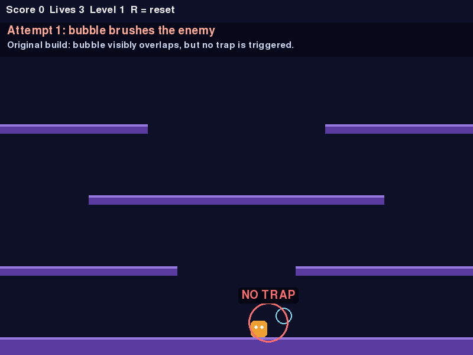
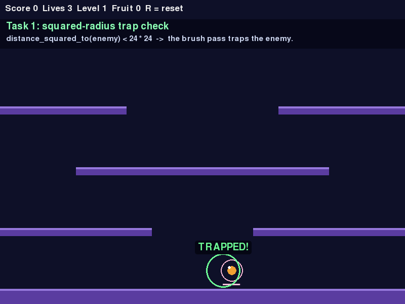

# Bubble Bobble Repair Lab — Completed

Single-file Pygame Bubble Bobble clone, repaired and extended for the Software Engineering lab. The original code is kept in [`legacy/game_before.py`](legacy/game_before.py) so the “before” recording is reproducible; the finished game is [`game.py`](game.py).

## Submission checklist

| # | Required deliverable | File | Status |
|---|---|---|---|
| 1 | 10-second gameplay video **before** the changes, showing the bug | [`media/before.mp4`](media/before.mp4) | 10.0 s · 800×600 · H.264 · 300 frames |
| 2 | 10-second gameplay video **after** the changes, showing the fix and new features | [`media/after.mp4`](media/after.mp4) | 10.0 s · 800×600 · H.264 · 300 frames |
| 3 | Complete LLM chat history (the “Chat/LLM used page”) | [`docs/LLM_CHAT_LOG.md`](docs/LLM_CHAT_LOG.md) | Full transcript + [raw JSON export](docs/chat_export.json) |

A one-page hand-in view is in [`SUBMISSION.md`](SUBMISSION.md). Technical write-up: [`docs/REPAIR_REPORT.md`](docs/REPAIR_REPORT.md).

| Before: overlap, no trap | After: trapped + tint + fruit + 1UP |
|---|---|
|  |  |

> **Repo page:** <https://github.com/TheNonConformist/26_bubbleBobble>
> Permanent deliverable links:
> <https://github.com/TheNonConformist/26_bubbleBobble/blob/main/media/before.mp4>,
> <https://github.com/TheNonConformist/26_bubbleBobble/blob/main/media/after.mp4>, and
> <https://github.com/TheNonConformist/26_bubbleBobble/blob/main/docs/LLM_CHAT_LOG.md>.
> This is a fork of the course template `SETAPESU26/26_bubbleBobble`; the full transcript is committed in `docs/`.

## What was completed

| Task | Where | What changed |
|---|---|---|
| 1. Bubble-trapping bug | `trap_enemies` | `distance_squared_to(...) < 24 * 2` → `< 24 * 24`. The left side is a squared distance, so the threshold must be a squared radius. |
| 2. `bubble_tint(bubble)` | module function | Trapped bubbles fade pink → amber → red and flash white in the last 2 seconds of their 8-second escape timer. Untrapped bubbles return `None` (default colour). |
| 3. `on_fruit_collected(fruit)` | module function | Adds a 16-particle sparkle burst, increments the HUD **Fruit** counter, shows a floating `+value` popup, and plays a short runtime-generated chime. |
| 4. `bonus_life_threshold()` | module function | Returns `5000`; one extra life is awarded whenever the score crosses a multiple of 5000. |

Extra polish (does not change the required API): escape-timer bar under trapped bubbles, combo/level/1UP floating text, a fruit icon, an optional no-asset pickup chime, and a multi-threshold bonus-life loop.

## Run the game

Requires Python 3.10+ and Pygame.

```bash
python -m pip install -r requirements.txt     # pygame-ce; API-compatible with pygame
python game.py
```

On Python ≤ 3.13, `pip install pygame` also works. The reference recordings were made with Python 3.14 and `pygame-ce 2.5.8`.

**Controls:** ←/→ move · ↑ jump · **Space** blow a bubble · **R** reset.

## Verify everything

```bash
python -m unittest discover -s tests -v
python tools/verify_submission.py
```

The suite has **14 checks** covering the squared-radius trap, tint interpolation/flash, fruit callback, 5000-point bonus, escapes, level advance and a draw smoke test. All 14 pass.

## How the videos were made

Both MP4s are generated from the real game loop, not screen-captured by hand:

```bash
python tools/record_demo.py --mode before --out media/before.mp4 --poster media/before_poster.png
python tools/record_demo.py --mode after  --out media/after.mp4  --poster media/after_poster.png
```

The recorder seeds `random`, steps the simulation at 60 Hz, renders at 30 fps, and pipes raw RGB frames to ffmpeg. The “before” run loads the untouched `legacy/game_before.py`; the “after” run loads `game.py`. It also prints the observed trap count and final score/lives/fruit state as an assertion that the intended behaviour happened.

### Video storyboard

**Before — `media/before.mp4`**

| Time | Shot |
|---|---|
| 0.0–0.9 s | Title: “BEFORE THE FIX”, original untouched build |
| 0.9–3.6 s | Attempt 1: bubble brushes the enemy, red “NO TRAP” marker |
| 3.6–6.3 s | Attempt 2: same input, same result |
| 6.3–9.0 s | Attempt 3: same input, same result |
| 9.0–10.0 s | Result card: **0 traps / 3 attempts**, `24 * 2` vs `24 * 24` |

**After — `media/after.mp4`**

| Time | Shot |
|---|---|
| 0.0–0.9 s | Title: “AFTER THE FIX”, corrected build |
| 0.9–3.9 s | Same brush pass now traps the enemy (green “TRAPPED!” marker); the escape-timer bar appears |
| 3.9–6.1 s | `bubble_tint()` showcase: three trapped bubbles start at 8 s / 5.5 s / 3.2 s remaining and tick down, fading and flashing |
| 6.1–9.3 s | Jump-pop the bubble from above → fruit drops → collected: sparkles, `+100`, Fruit counter → 1, score crosses 5000 → **1UP!** |
| 9.3–10.0 s | Completion card: 4/4 tasks |

## Repository map

```text
26_bubbleBobble/
├── game.py                    # completed game (submission build)
├── legacy/
│   ├── game_before.py         # exact original (bug preserved)
│   └── README_before.md       # original lab brief
├── media/
│   ├── before.mp4             # required 10 s video, bug visible
│   ├── after.mp4              # required 10 s video, fixed + features
│   ├── before_poster.png
│   └── after_poster.png
├── docs/
│   ├── REPAIR_REPORT.md       # root-cause analysis, design, tests
│   ├── LLM_CHAT_LOG.md        # readable complete chat transcript
│   ├── chat_export.json       # raw OpenCode session export
│   └── game.diff              # original vs completed source
├── tests/test_game.py         # 14 automated checks
├── tools/
│   ├── record_demo.py         # deterministic MP4 recorder
│   ├── export_chat.py         # session JSON → Markdown
│   ├── sanitize_chat.py       # redact local details before publishing
│   └── verify_submission.py   # deliverable/content checker
├── SUBMISSION.md              # the three deliverables in one page
├── requirements.txt
└── Makefile
```

## The bug in one line

`Vector2.distance_squared_to()` returns **d²**. Comparing it to `24 * 2 = 48` only traps when `d < √48 ≈ 6.93 px`. Squaring the radius (`24 * 24 = 576`) makes the check `d < 24 px`, which matches a bubble visually brushing a 28 px enemy. The fix is one line; the tests pin the behaviour at 20 px (trap) and 30 px (no trap).
